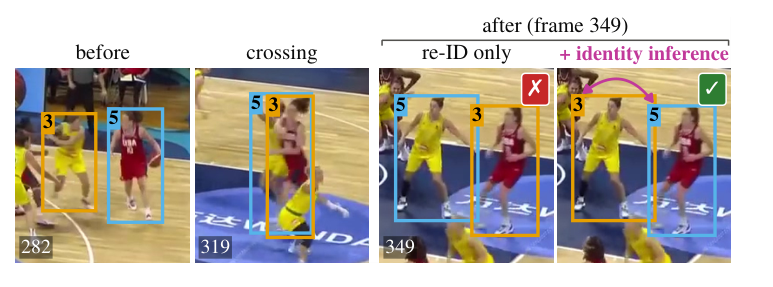
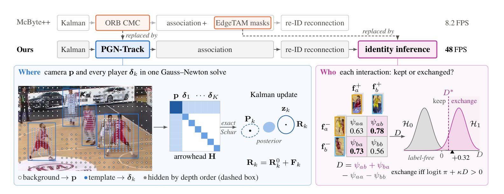
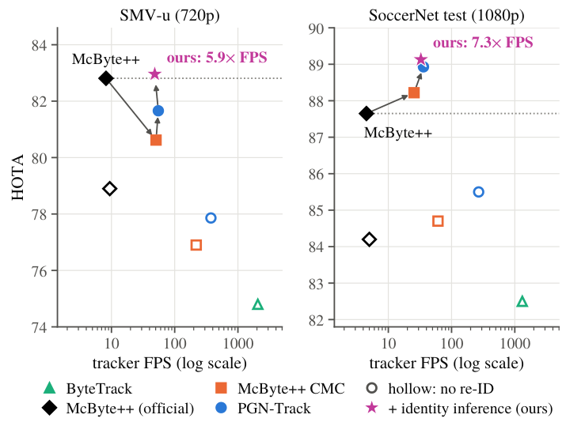

# Where and Who: Photometric Registration and Label-Free Identity Inference for Fast Training-Free Sports Tracking

<p align="center"></p>

<p align="center"><i>Re-identification alone leaves this exchange in place; identity inference undoes it.</i></p>

## Overview

<p align="center"></p>

Leading training-free trackers for team sports extend ByteTrack with camera motion compensation (CMC), mask
propagation, and re-identification; the masks make them accurate but slow. We replace CMC and the masks with two
light layers that decide *where* each player is and *who* each track is:

- **Where: PGN-Track.** One Gauss–Newton problem on image intensities estimates the camera motion and a residual
  displacement of every player together, skips template samples hidden behind a player in front (depth order), and
  feeds each player's position to the Kalman filter as a measurement.
- **Who: identity inference.** Once two crossing players separate, a likelihood ratio of their appearance before and
  after the crossing, calibrated on the unlabeled videos themselves, and an EM prior decide whether their labels were
  exchanged; no decision threshold is tuned.

At about the speed of McByte++ without masks, our tracker is 2.2 HOTA more accurate on the SportsMOT test server and
surpasses McByte++ with masks at about six times its speed.

This repository contains our method and the three trackers it builds on (ByteTrack, McByte, McByte++). Every
component is a switch in a YAML config, and each method of the paper is a preset.

## Installation

```bash
pip install -r requirements.txt      # tracking, re-ID, evaluation
pip install -e .
```

- PyTorch is used by PGN-Track (one CUDA graph per frame on a GPU; the CPU gives the same outputs, only slower).
- The mask presets (`mcbyte`, `mcbytepp`) additionally need EdgeTAM (McByte++), or SAM and Cutie (McByte), listed at
  the end of `requirements.txt`. No other preset needs them.

**Weights** (under `$WEIGHTS_ROOT`):

| file | used by |
|---|---|
| `sports_model.pth.tar-60` | OSNet x1.0 trained on SportsMOT (released with Deep-EIoU and GTA-link): re-ID reconnection and identity inference |
| `osnet_x1_0_msmt17.pth` | generic person re-ID (ablation) |
| `edgetam.pt` | McByte++ masks |
| `sam_vit_b_01ec64.pth`, `cutie-base-mega.pth` | McByte masks |

## Data

```
$DATA_ROOT/
  sportsmot/{val,test}/<seq>/img1/*.jpg     # SportsMOT (val also provides gt/)
  soccernet/tracking/test/<seq>/            # SoccerNet-Tracking 2022 test (det/det.txt = ground-truth boxes)
  dancetrack/val/<seq>/                     # DanceTrack validation
  mot17/val_half/<seq>/                     # MOT17 val-half (second half of the training sequences)
$DET_ROOT/<split>/<seq>.npy                 # cached detections: rows (frame, x1, y1, x2, y2, score)
```

- **SportsMOT** (validation and test) uses the YOLOX-X detector released with the dataset.
- **SMV-u** (our validation protocol) is the SportsMOT validation split detected by the same architecture trained on
  the training split only (MixSort's `yolox_x_sports_train`, test size 800 × 1440, confidence 0.01, NMS 0.7). It
  removes the detector's knowledge of the validation videos.
- **SoccerNet-Tracking** uses its ground-truth boxes, so no detector is needed.

Re-running the fp16 detector is not bit-exact, so the numbers are reproduced exactly only from the same cached
detections.

## Running

```bash
export DATA_ROOT=/path/to/data DET_ROOT=/path/to/detections WEIGHTS_ROOT=/path/to/weights

# ByteTrack + PGN-Track on SMV-u (no re-ID)
python tools/track.py --method configs/methods/pgn_track.yaml --data configs/datasets/smvu.yaml

# The tracker under identity inference: McByte++ without masks, PGN-Track in place of its CMC
python tools/track.py --method configs/methods/pgn_track_reid.yaml --data configs/datasets/smvu.yaml --gpus 0
```

Identity inference is applied to the saved outputs (this produces the paper's accuracy numbers). The warm start of
online calibration is the evidence of the other dataset: SoccerNet for the SportsMOT splits, SMV-u for SoccerNet.

```bash
# evidence of each split (batch calibration)
python tools/identity_offline.py --method configs/methods/ours_batch.yaml --data configs/datasets/soccernet_test.yaml \
    --base results/pgn_track_reid/soccernet_test --out results/ours_batch/soccernet_test
python tools/identity_offline.py --method configs/methods/ours_batch.yaml --data configs/datasets/smvu.yaml \
    --base results/pgn_track_reid/sportsmot_valtr --out results/ours_batch/sportsmot_valtr

# ours (online calibration, the paper's default)
python tools/identity_offline.py --method configs/methods/ours.yaml --data configs/datasets/smvu.yaml \
    --base results/pgn_track_reid/sportsmot_valtr --evidence results/ours_batch/sportsmot_valtr/evidence.json \
    --warm results/ours_batch/soccernet_test/evidence.json --out results/ours/sportsmot_valtr
```

The same layer also runs inside the tracker loop, the path that was timed. Set `identity.calib` to the warm-start
evidence file. For fixed κ and π, its output is identical to the offline tool's.

### Methods (`configs/methods/`)

| preset | tracker |
|---|---|
| `bytetrack.yaml` | ByteTrack in McByte's configuration |
| `bytetrack_cmc.yaml` | + McByte++ CMC (conditional ORB, 1/4 resolution) |
| `pgn_track.yaml` | + PGN-Track instead of CMC |
| `mcbyte.yaml` | McByte: ORB CMC (1/2) + SAM / Cutie masks |
| `mcbytepp.yaml` | McByte++: CMC + EdgeTAM masks + re-ID reconnection |
| `mcbytepp_noreid.yaml` | McByte++ without re-ID |
| `mcbytepp_nomask.yaml` | McByte++ without masks |
| `pgn_track_reid.yaml` | McByte++ without masks, PGN-Track instead of CMC |
| `ours.yaml` | `pgn_track_reid` + identity inference, online calibration |
| `ours_batch.yaml`, `ours_cross.yaml` | batch calibration / calibration on the other dataset only |

### Switches

Any value can be changed with `--set key=value`, and `configs/ablations/` holds the ablations of the paper.

| key | values | meaning |
|---|---|---|
| `motion.type` | `none`, `cmc`, `pgn` | motion stage |
| `motion.cmc.variant` | `mcbyte`, `mcbytepp` | ORB at 1/2, conditional ORB at 1/4 |
| `motion.pgn.layers` | `true`, `false` | depth-ordered visibility of template samples |
| `motion.pgn.prior` | `PF`, `P` | prior information (P_k + F_k)^-1 or P_k^-1 |
| `motion.pgn.alpha` | `0.05`, `0` | offset term F_k (0 removes it) |
| `motion.pgn.bridge` | `kalman`, `box` | Kalman update with (z_k, R_k), or displacement added to the box |
| `motion.pgn.camera_only` | `true`, `false` | camera registration without track terms |
| `motion.pgn.esm`, `levels`, `warm_start`, `fallback` | see `configs/methods/pgn_track.yaml` | solver options |
| `masks.type` | `none`, `mcbyte`, `mcbytepp` | mask propagation and mask cues |
| `reid.type` | `none`, `reconnection` | McByte++ online re-ID reconnection |
| `identity.type` | `none`, `online`, `batch`, `cross` | identity inference and its calibration |
| `identity.prior`, `identity.kappa_scale` | `em` or a fixed π; a scale of κ | sensitivity analysis |

## Evaluation

```bash
python tools/evaluate.py --data configs/datasets/smvu.yaml --results results/ours/sportsmot_valtr
# paired per-sequence bootstrap against another tracker (10,000 resamples, 95% interval)
python tools/evaluate.py --data configs/datasets/smvu.yaml --results results/ours/sportsmot_valtr \
    --baseline results/pgn_track_reid/sportsmot_valtr
```

HOTA and IDF1 come from TrackEval with the settings of the paper (SoccerNet without preprocessing, as in its
official evaluation script). For the SportsMOT test split, submit the results to the evaluation server.

`tools/timing.py` measures the motion stage as in the paper: one process, one CPU thread, no detection or decoding.

## Results

HOTA / IDF1 on identical detections. FPS counts the tracker only, on one RTX A6000, at 1080p (SoccerNet) and 720p
(SportsMOT).

| tracker | SoccerNet test | SportsMOT test | SportsMOT val | SMV-u | FPS (SN / SMOT) |
|---|---|---|---|---|---|
| ByteTrack (McByte config.) | 82.5 / 76.5 | – | 80.5 / 79.7 | 74.8 / 75.5 | 1312 / 2063 |
| + McByte++ CMC | 84.7 / 79.4 | 74.2 / 74.3 | 82.2 / 81.7 | 76.9 / 78.0 | 61 / 219 |
| + PGN-Track | 85.5 / 80.3 | 74.9 / 75.2 | 82.7 / 82.5 | 77.9 / 79.3 | 268 / 374 |
| McByte++ (masks, re-ID) | 87.6 / 84.5 | 79.8 / 83.6 | 85.7 / 87.6 | 82.8 / 87.2 | 4.5 / 8.2 |
| McByte++ w/o masks | 88.2 / 85.1 | 78.1 / 81.3 | 86.1 / 88.0 | 80.6 / 84.2 | 25.5 / 50.7 |
| CMC → PGN-Track | 88.9 / 85.9 | 78.9 / 82.4 | 86.7 / 88.8 | 81.7 / 85.5 | 35.9 / 55.1 |
| **+ identity inference (ours)** | **89.1 / 86.1** | **80.3 / 84.2** | **87.3 / 89.5** | **83.0 / 87.3** | 32.7 / 48.4 |

<p align="center"></p>

**Reproducibility.** On a given device the outputs are deterministic. Between GPU and CPU, floating-point rounding
can flip a few decisions at a threshold in some re-ID runs and numerically fragile ablations (HOTA changes by at most
0.13).

## Acknowledgement

This code builds on [ByteTrack](https://github.com/FoundationVision/ByteTrack) (MIT),
[McByte](https://github.com/tstanczyk95/McByte) (MIT), and
[McByte++](https://github.com/tstanczyk95/McBytePlusPlus) (Apache-2.0); ported parts keep their license headers (see
`NOTICE`). It uses [EdgeTAM](https://github.com/facebookresearch/EdgeTAM),
[SAM](https://github.com/facebookresearch/segment-anything), [Cutie](https://github.com/hkchengrex/Cutie),
[OSNet / torchreid](https://github.com/KaiyangZhou/deep-person-reid),
[TrackEval](https://github.com/JonathonLuiten/TrackEval), and [YOLOX](https://github.com/Megvii-BaseDetection/YOLOX),
and evaluates on [SportsMOT](https://github.com/MCG-NJU/SportsMOT),
[SoccerNet-Tracking](https://github.com/SoccerNet/sn-tracking), [DanceTrack](https://github.com/DanceTrack/DanceTrack),
and [MOT17](https://motchallenge.net/). We thank their authors.

## License

MIT (see `LICENSE`); third-party notices in `NOTICE`.
